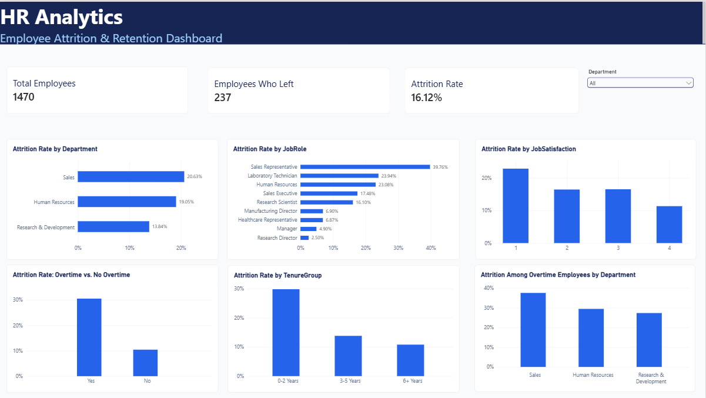

# HR Analytics: Employee Attrition Analysis

## Project Overview

This project analyzes employee attrition using the IBM HR Analytics Employee Attrition dataset. The goal is to identify patterns associated with employee turnover across departments, job roles, overtime status, tenure, and job satisfaction.

The project uses Python (Pandas), SQL, and Power BI to explore the data, calculate key metrics, and present actionable business insights.

## Tools & Technologies

- **Python:** Data analysis using Pandas
- **SQL:** Data exploration and business queries
- **Power BI:** Interactive dashboard and visualizations
- **Git & GitHub:** Version control and project hosting

## Dataset

- **Employees:** 1,470
- **Features:** 35 columns
- **Target variable:** Attrition (Yes/No)

The dataset contains employee-related information such as department, job role, monthly income, years at company, overtime, and job satisfaction.

## Key Findings

- Overall employee attrition was **16.12%** (237 employees).
- The Sales department had the highest attrition rate at **20.63%**, followed by Human Resources at **19.05%**.
- Employees working overtime had an attrition rate of **30.53%**, compared with **10.44%** for employees who did not work overtime.
- Employees with 0–2 years of tenure had an attrition rate of **29.82%**, compared with **10.81%** among employees with 6 or more years of tenure.
- Sales Representatives had the highest attrition rate among job roles at **39.76%**.
- Employees who left had a lower average tenure (5.13 years) than employees who stayed (7.37 years).

These findings show associations in the dataset and should not be interpreted as proof of causation.

## Power BI Dashboard

The interactive dashboard summarizes employee attrition through KPI cards, department comparisons, job-role analysis, overtime patterns, tenure groups, and job satisfaction. A department slicer allows users to explore the results by department.



## Project Structure

```text
HR-Analytics/
├── data/
│   └── raw/
│       └── HR-Employee-Attrition.csv
├── insights/
│   └── business-insights.md
├── powerbi/
│   └── HR-Analytics-Dashboard.pbix
├── python/
│   └── first.py
├── screenshots/
│   └── HR_Analytics_Dashboard.png
├── sql/
│   └── hr_analytics_queries.sql
├── .gitignore
└── README.md
```

## How to Explore the Project

1. Review `insights/business-insights.md` for the main findings.
2. Open `sql/hr_analytics_queries.sql` to explore the SQL analyses.
3. Review `python/first.py` for the Python and Pandas analysis.
4. Open `powerbi/HR-Analytics-Dashboard.pbix` in Power BI Desktop to interact with the dashboard.

## Conclusion

This project demonstrates a practical data analytics workflow: exploring employee data, analyzing attrition patterns, querying business metrics, and communicating findings through a dashboard.

**Note:** The analysis describes patterns in the provided dataset; it does not establish the causes of employee attrition.
